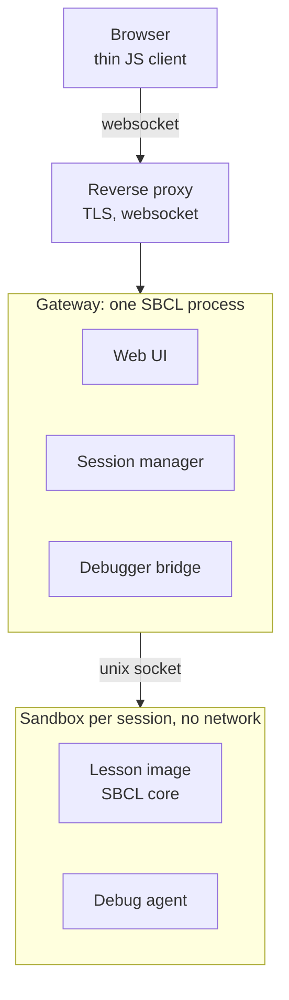
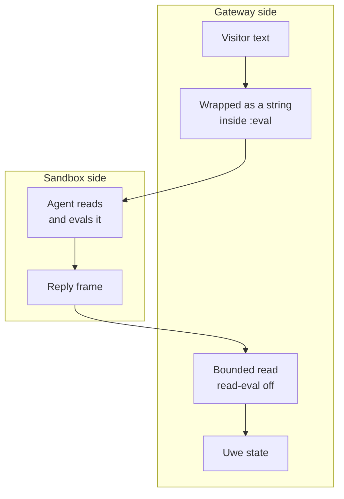
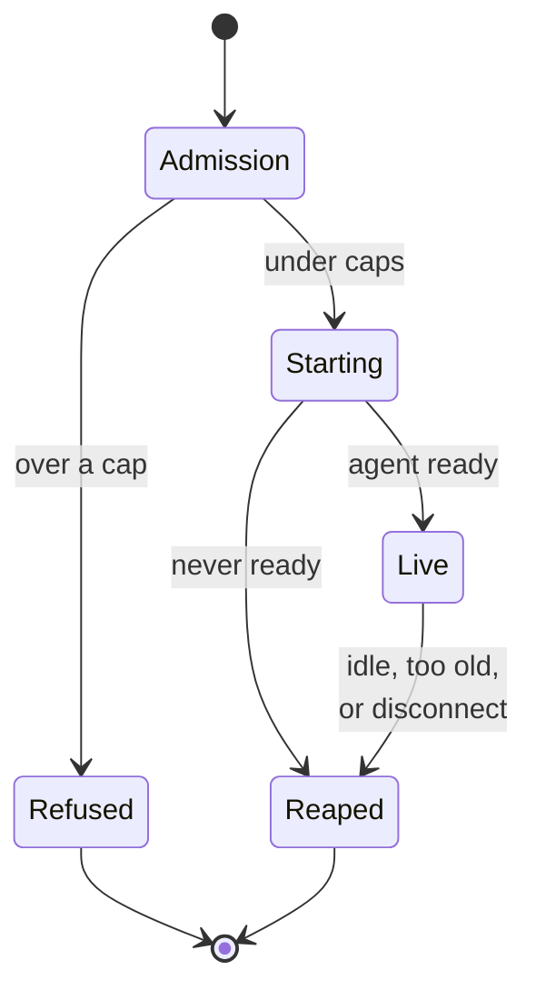
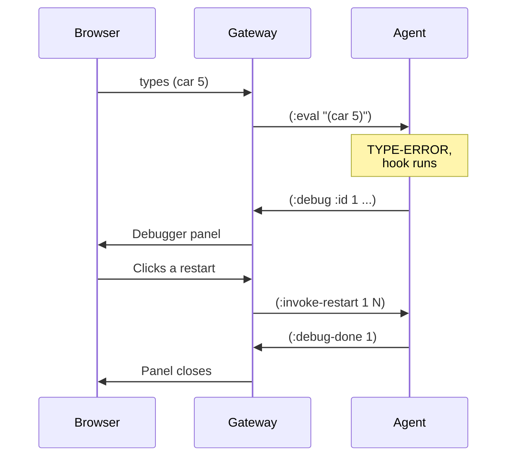
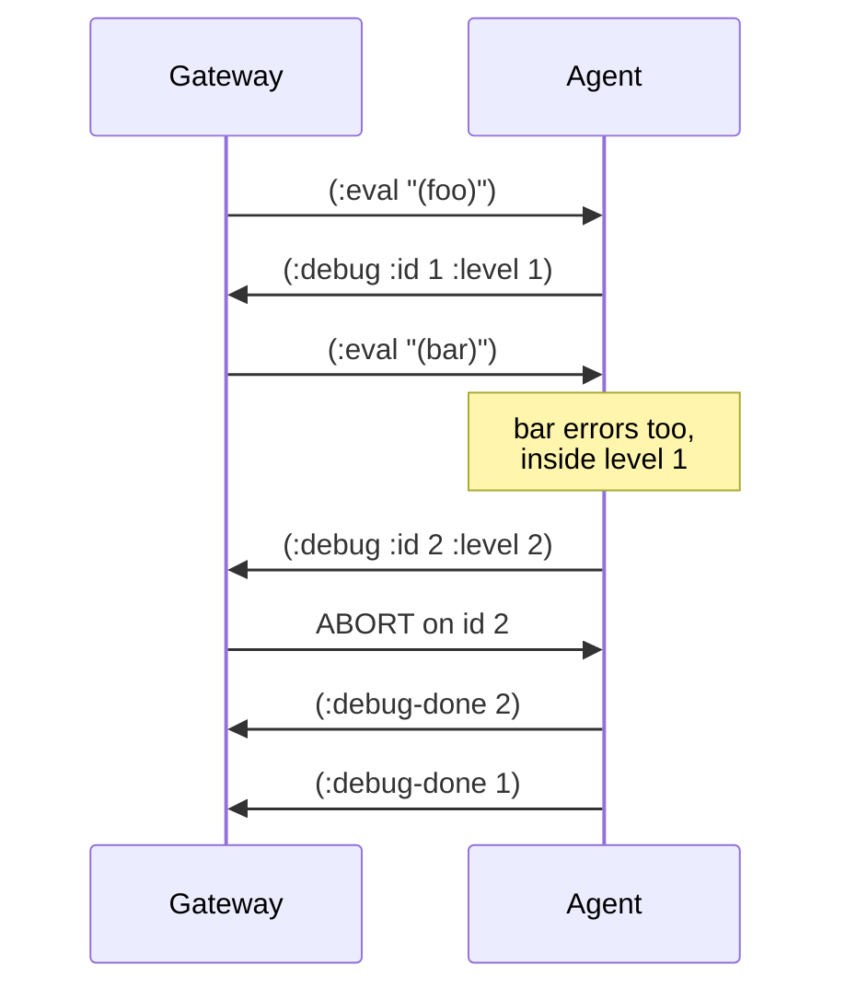
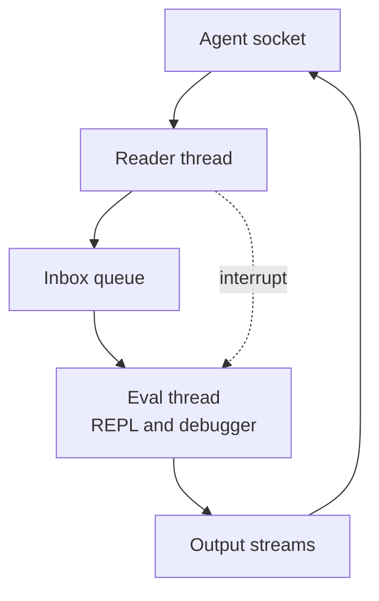
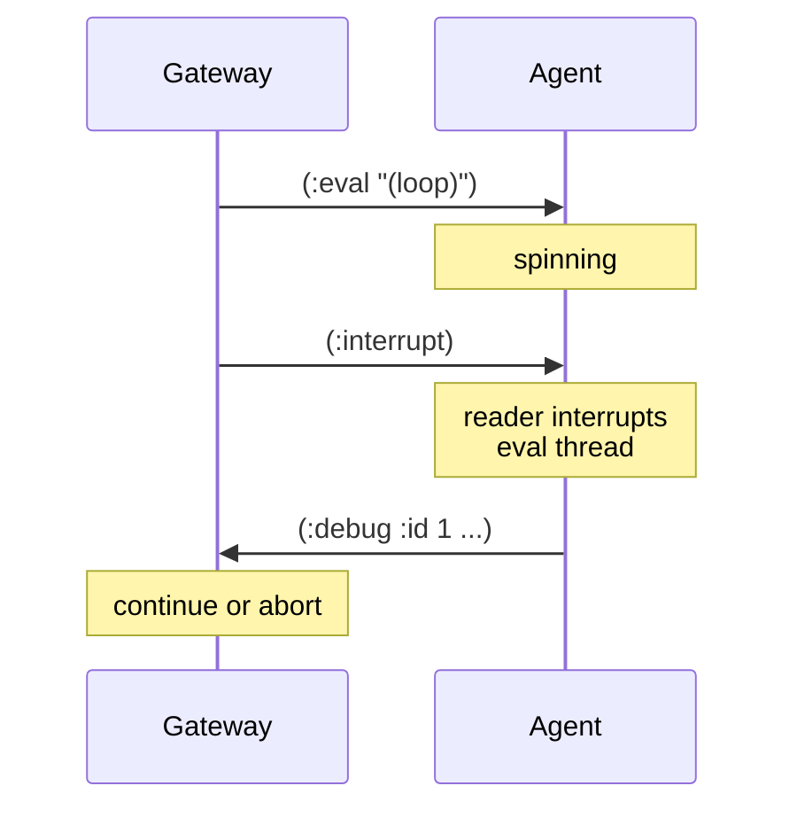
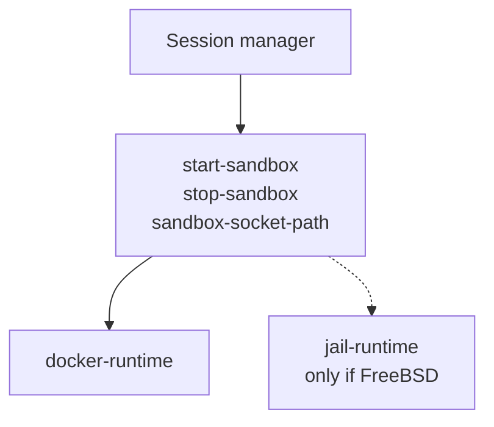
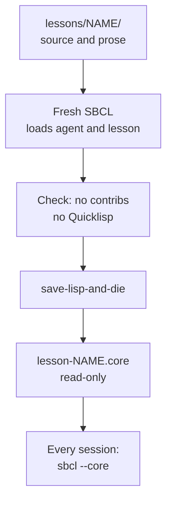

# Architecture

## The Shape

My vision is a visitor opens a page and gets served a REPL backed by a real SBCL image, with nothing to install.
You type `(car 5)`, and instead of a wall of text you get the condition, a button per restart, and a backtrace.
You pick one and keep going.
That's the whole demo - it shows how cool live image programming is.



Gray is the non-Lisp edge, blue is the gateway, amber is the sandbox where visitor code runs.
The reverse proxy and the sandbox are the only parts that aren't Lisp, and I'd like to keep it that way.

**Reverse proxy.**
Terminates TLS and upgrades the websocket.
The Lisp web server never faces the internet directly.

**Gateway.**
One SBCL process with the web UI, the session manager and the debugger bridge in it.
It can use libraries (a few) and Quicklisp is fine for developing it.

**Sandbox.**
A disposable container (Linux) or jail (FreeBSD). 
Visitors get one per session and it is thrown away when the session ends.

**Lesson image.**
An SBCL core with ANSwe Common Lisp, a debug agent, and one lesson's code in it.

**Debug agent.**
Zero-dependency code living in every lesson image.
It runs the REPL, ships output back, and replaces the terminal debugger with one that sends restarts to the gateway as data.
The key is that its just transiting data

## The Wall

There is just on e security boundary: the sandbox wall.
Everything inside it belongs to the visitor, including the agent.
Visitor code runs in the same image, so it can redefine agent functions or write straight to the socket if it wants to.
I'm totally fine with that, because nothing outside the wall trusts the agent at all.



**Going in, visitor text is just a string.**
The gateway never calls `read` or `eval` on anything a visitor typed.
It puts the text in a string inside `:eval` and forwards it, and the only `read` that ever touches it happens inside the sandbox.

**Coming out, any frame could be forged.**
Visitor code can write whatever the hell it likes to the socket, so the gateway reads agent frames the way it would read anything off the internet.
`*read-eval*` is bound to `nil` on every read (on both ends), but that alone doesn't cover it.
You can forge a frame that can still intern a pile of symbols, nest a million parens deep, or claim a length of four gigabytes.
The gateway will cap the frame length before it reads anything, and for now reads with only the keyword package current.
That still lets a forged `cl-user::x` intern into a real package, and every new keyword sticks around, which is why the reader isn't settled.
Maybe I'll use `cl:read` under tight bindings or a tiny parser that only knows keywords, strings, integers and lists is open.
we lean toward the tiny parser, since the message shapes are small and fixed and then there's nothing to reason about.
Also, we just like parsers.

**No sandboxing inside Lisp.**
CL can't restrict code in a running image (`#.`, `sb-ext:run-program`, the FFI, just redefining `cl` functions), so I'm just not gonna pretend that we can.
No package locks, no symbol whitelists.
They'd only make it look safer than it is.
It's just straight up a little dangerous.

## A Session



1. **Admission.**
   The websocket opens and asks for a lesson.
   The session manager checks the per-IP cap, the global cap, and the creation rate, and turns the session away if any of them is over.
2. **Starting.**
   It draws a random 128-bit session id, starts listening on the socket at `sandbox-socket-path`, then calls `start-sandbox`, and the sandbox runs `sbcl --core lesson-NAME.core`.
   The agent connects as soon as its image starts, the gateway accepts and waits for `(:ready)`, and the Uwe says "starting" until it shows up.
   If it never shows up, the session gets reaped like any other; we really don't think we need a separate failure path for that.
3. **Live.**
   The gateway relays input down and output, values and debugger state back up.
4. **Reaped.**
   Whichever comes first of the idle timeout, the max lifetime, or the browser going away.
   The session manager calls `stop-sandbox` and the whole thing is gone.

Reloading the page gets you a brand new sandbox from the same read-only core.
Nothing carries over, which is kind of the point of starting inside an image: you can always get the clean one back.

## Restarts

Here's what happens on `(car 5)`:



The agent's debugger hook sends the condition type, its report, the `compute-restarts` list (index, name and report for each), and a backtrace.
Then it sits and waits for the gateway to say which one, and calls `invoke-restart` on it.
Roughly:

```lisp
;; sketch: NOT the real deal 
(defun agent-debugger-hook (condition old-hook)
  (declare (ignore old-hook))
  (let ((restarts (compute-restarts condition))
        (id (next-debug-id)))
    (send-message
     `(:debug :id ,id
              :level ,*debug-level*
              :type ,(prin1-to-string (type-of condition))
              :report ,(princ-to-string condition)
              :restarts ,(loop for r in restarts
                               for i from 0
                               collect (list i
                                             (prin1-to-string (restart-name r))
                                             (princ-to-string r)))
              :backtrace ,(backtrace-strings)))   ; the SBCL-only bit
    ;; blocks this thread until the visitor picks something
    (debugger-loop id restarts)))
```

The agent also wraps every form it evaluates in a `retry` restart and every top-level `:eval` in the one `abort`. 
Even `(car 5)`, which should have no restarts of its own, gets two buttons instead of one.
`retry` is the one that matters: fix the function from inside the debugger, hit RETRY, and the form that failed runs again.
Lessons with a planted bug bring their own `restart-case` and those show up alongside.

**One SBCL thing to check.**
ANSwe `break` binds `*debugger-hook*` to `nil`, so `(break)` would skip the hook and fall into the terminal debugger (which people can't see).
SBCL has `sb-ext:*invoke-debugger-hook*` for exactly this type of situation.
`invoke-debugger` consults it first and `break` leaves it alone which we verified against SBCL 2.6.9.

**Restarts that want a value.**
`use-value` and `store-value` need an argument, and the draft messages have nowhere to put one.
we think the panel asks for a form, sends it as a string, and the agent reads it inside the sandbox, so the gateway rule about never reading visitor text still holds.
I'm pretty open for how this plays out.

## Nested Levels

While a debugger level is open you can keep typing, same as SLIME.
That input gets evaluated inside the open level, so an error there opens level 2 on top of level 1.



`ABORT` is always on the list and always goes back to the top-level REPL, and it closes each and every open level on the way out.
Other restarts just close the level that they belong to.
The bridge keeps the stack of open levels so the panel can show which level a button belongs to.

This is also why `debugger-loop` in the sketch is a loop and not a single wait.
The loop takes the next message, and if it's `:eval` it evaluates it right there (where another error recurses into the hook), and if it's `:invoke-restart` for its own id it invokes the restart and unwinds.
That's basically how SBCL's own debugger REPL works (more or less.)

## The Agent



Two additional threads
`:interrupt` has to arrive while the eval thread is busy running a `(loop)`, so something other than the eval thread has to be reading the socket.

- **Reader thread.**
  Reads frames, answers `:ping` itself, and handles `:interrupt` by calling `sb-thread:interrupt-thread` on the eval thread.
  Everything else goes into the inbox.
- **Eval thread.**
  Pulls from the inbox, evaluates, sends `:values`.
  It also runs the debugger loop above, which pulls from the same inbox.
- **Output.**
  `*standard-output*` and `*error-output*` are bound to streams that send `:output` frames.
  Both threads write to the socket, so writes go through one mutex (unless we can figure out a mutexless setup)

The agent can't use a socket or JSON library (nothing beyond ANSwe goes in the image), so it frames its own messages.
SBCL's socket library, `sb-bsd-sockets`, is a contrib and stays out too, so the agent calls `socket()` and `connect()` itself through `sb-alien`, which is in the base image.
Its inbox is likewise a plain list behind an `sb-thread` mutex rather than the `sb-concurrency` contrib.
Backtraces, frame inspection and thread interrupts aren't ANSI, so all of that lives in one SBCL-specific file and the rest stays portable.

**Interrupting.**
The interrupt lands in the debugger like any other condition, which we really like, because it means `(loop)` doesn't just die.
You get a panel with `continue`, and you can let it keep spinning if you want.
we mean, this is like the charm of Lisp.



## The Wire

Gateway and agent swap length-prefixed S-expressions over the per-session unix socket.
The browser never sees any of it.

These are fixed:

| Property | Rule |
|---|---|
| Transport | One unix socket per session, in a directory shared into the sandbox. |
| Encoding | One S-expression per message, headed by a keyword. |
| Framing | A length prefix on every frame, modeled on Swank's fixed-width hex. |
| Reading | `*read-eval*` bound to `nil` on every read, both ends. |
| Opacity | Visitor code rides as a string inside `:eval`; the gateway never parses it. |

A frame on the wire: six lowercase hex digits, Swank's width, then the printed form:

```
000011(:eval "(car 5)")
```

```lisp
;; sketch: NOT real code
(defun write-frame (message stream)
  (let ((text (with-standard-io-syntax
                (let ((*package* (find-package :keyword)))
                  (prin1-to-string message)))))
    (format stream "~(~6,'0x~)~a" (length text) text)
    (finish-output stream)))
```

**The length counts characters.**
Both ends open the socket as a UTF-8 character stream, so the prefix counts characters, not bytes, and a `λ` counts as one.
Counting bytes would let the reader size its buffer before decoding, but it would mean encoding UTF-8 by hand or reaching past ANSI.
Since both ends are Lisp, I'm comfortable with this.
The reader still checks the length against a cap before it reads the body.

The message list itself isn't fixed.
Once the agent exists, it lives in one protocol definition shared by agent and gateway, with round-trip tests on both ends, and changing a message is just a code change.
This is where it starts:

| Direction | Message | Meaning |
|---|---|---|
| Down | `(:eval "form string")` | Read and evaluate the visitor's text. |
| Down | `(:invoke-restart ID INDEX)` | Answer the open `:debug` with that id. |
| Down | `(:interrupt)` | Interrupt the eval thread. |
| Down | `(:ping)` | Still there? |
| Up | `(:ready)` | Listening. |
| Up | `(:output "text")` | A chunk of output. |
| Up | `(:values ("printed value" ...))` | Printed values of a finished eval. |
| Up | `(:debug :id ID :level N ...)` | A debugger level opened. |
| Up | `(:debug-done ID)` | That level closed. |
| Up | `(:pong)` | Still here. |

## Printing

Values come back as printed strings (never as objects!!) so nothing in the image ever has to be read back on the gateway side as Lisp data.
That moves the problem to printing, and visitors will absolutely type this (making me roll my eyes)

```lisp
(let ((x (list 1 2 3)))
  (setf (cdr (last x)) x))   ; prints forever unless we stop it
```

So the agent prints values (and backtrace frames) with `*print-circle*` on and `*print-length*` and `*print-level*` set, and cuts any one printed value off at a size limit.
Same idea for `:output`: `(loop (print 'hi))` is a perfectly reasonable thing to type, so the agent batches output into chunks and the gateway caps the scrollback and drops the oldest lines.
The visitor can always interrupt it.
The actual limits get picked when we can watch it happen in a browser.

## The Sandbox

Every session sandbox gets:

- No network.
- A read-only root and a small tmpfs.
- CPU, memory and process-count limits, plus a wall-clock timeout.
- A non-root user, all capabilities dropped, and seccomp (or whatever a jail's version of that is).
- An idle timeout and a max lifetime, which the gateway enforces, not the sandbox.

It's hardened when a fork bomb, a memory hog, an infinite loop and an outbound connection attempt are each boring.
If plain containers turn out too thin, gVisor or Firecracker are next, and we decide that once the prototype works.



The gateway only ever talks to a sandbox through three generic functions, so hosting doesn't leak into it while FreeBSD jails versus Linux is still open:

```lisp
(defgeneric start-sandbox (runtime lesson session))   ; => handle
(defgeneric stop-sandbox (runtime handle))
(defgeneric sandbox-socket-path (runtime handle))     ; => pathname
```

`docker-runtime` goes first because it's easy to run on a laptop.
`jail-runtime` only gets built if the cost comparison comes out for FreeBSD.
Both shell out through `uiop:run-program`, and the Docker one is mostly a list of flags:

```lisp
;; sketch, limits come from the runtime object
(defmethod start-sandbox ((runtime docker-runtime) lesson session)
  (uiop:run-program
   (list "docker" "run" "--detach" "--rm"
         "--network" "none"
         "--read-only" "--tmpfs" "/tmp"
         "--memory" (memory-limit runtime)
         "--cpus" (cpu-limit runtime)
         "--pids-limit" (pids-limit runtime)        ; fork bombs stop here
         "--user" "lisp"
         "--cap-drop" "ALL"
         "--security-opt" "no-new-privileges"
         "--volume" (format nil "~a:/run/agent" (socket-dir session))
         (lesson-image lesson))
   :output '(:string :stripped t)))                 ; container id is the handle
```

No network means the socket can't be TCP, so it sits in a directory shared into the sandbox: a bind mount for Docker, nullfs for a jail.
The gateway listens and the agent connects.
That way the agent only needs `socket()` and `connect()`, the gateway never has to poll for a socket file to show up, and the shared directory can be mounted read-only, since the sandbox never creates anything in it.
we haven't checked the file permissions on that socket yet: the gateway creates it, and the sandbox's user needs write permission on it to connect, which is a per-backend detail to verify.
Docker also has no wall-clock limit of its own, so the gateway covers that with the max lifetime and `stop-sandbox`.

## Lessons



A lesson is a directory with Lisp source, optional prose, and a build step.
You start inside the running image rather than reading a program, which is the other thing (besides the debugger) that makes CL feel different, and a lesson shipped as source to read would hide it.

Only ANSwe CL, the agent and the lesson's own code go in the core.
No Quicklisp, no contribs, and the build fails if a contrib got loaded.
If a lesson needs something beyond ANSI, the lesson writes it.
A visitor who watches a library do the interesting part learned about the library.

Cores are built once and never written to.
Whether each lesson gets its own Docker image, or there's one SBCL image and the cores get mounted in read-only, is open; we lean toward the second, since then rebuilding a lesson doesn't mean rebuilding an image.

Core size and per-session memory decide how many sessions fit on one box, and whether sessions can share the core's pages is the number we most want to see.
SBCL is the only implementation on the server, pinned at the version in `sbcl-version` at the repo root (2.6.9).

## The Panel

The Uwe is a scrollback, an input line with history, the debugger panel, and lesson prose next to it.
The panel is the part that matters, so any front end gets judged on it first.
For a lesson with a planted bug it'd look something like:

```
+-- SIMPLE-ERROR  (level 1) ----------------------------+
| Can't parse "twelve" as a price.                      |
|                                                       |
|  [ USE-VALUE ]   Use a different price.               |
|  [ SKIP-ROW ]    Skip this row and keep going.        |
|  [ RETRY ]       Evaluate the form again.             |
|  [ ABORT ]       Back to top level.                   |
|                                                       |
|  > backtrace (click to open)                          |
+-------------------------------------------------------+
```

CLOG (drives the DOM from Lisp over a websocket) is the first thing we try.
If it fights a REPL widget, the fallback is a small hand-written JS terminal and Spinneret pages.

## Layout

```
to-restart-is-divine.asd ; systems: wire, agent, link, gateway, web, tests (lessons later)
sbcl-version             ; the pinned SBCL
agent/                   ; zero-dependency debug agent, and the wire framing it shares
gateway/                 ; socket link, sessions, web page, runtimes, bridge
lessons/                 ; one directory per lesson, plus the build script
deploy/                  ; container and jail definitions, proxy config
test/
```

## Rules

These hold no matter what else changes, and breaking one is a design change, not a bug fix.

- The gateway never `read`s or `eval`s visitor text.
- No socket is ever read with `*read-eval*` on.
- No sandbox gets network.
- The Lisp web server is only ever behind the proxy.
- Nothing but ANSwe CL, the agent and the lesson goes in a lesson image.
- Nothing about containment depends on Lisp.
- Nothing goes on the internet until the sandbox limits are in.

## Open

- **CLOG or thin JS.**
  Closed by building the debugger panel in CLOG and seeing whether it fights us.
- **Jails or Linux.**
  Closed by the hosting cost comparison; the runtime functions keep the gateway out of it until then.
- **Gateway parser.**
  `cl:read` under tight bindings or the tiny parser.
  Closed when the gateway's reading side gets written.
- **Containers, gVisor or Firecracker.**
  Closed by the hardening tests once the prototype works.
- **Memory per session and shared core pages.**
  Closed by measuring the first real core.
- **ECL in the browser.**
  If ECL compiled to WebAssembly can run `restart-case`, signal a `type-error` and hand back the restart list, there's a mode with no gateway or sandbox at all.
  Closed by a short time-boxed spike.
  JSCL is out, since it's a subset with no documented condition system.
- **Download your own image.**
  `save-lisp-and-die` ends the process, so snapshotting a live session probably means forking a child first, and nobody's checked how that behaves with threads.
  Parked.
